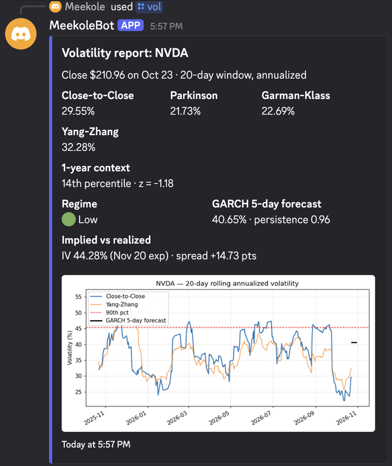

# VolBot: Discord Stock Volatility Bot

A Discord bot that measures, forecasts and alerts on stock volatility. Each server keeps its own watchlist. Every trading day after the close, the bot posts a report for each ticker with four volatility estimators, a chart, a GARCH forecast and the gap between implied and realized volatility. It also alerts the channel when a stock's volatility moves into a new regime.

<!-- Add a screenshot of a real report here, e.g.  -->

## Commands

| Command | What it does |
|---|---|
| `/vol <ticker>` | Full report and chart for any ticker |
| `/watch add <ticker>` | Add a ticker to this server's watchlist |
| `/watch remove <ticker>` | Remove a ticker |
| `/watch list` | Show the watchlist |
| `/accuracy [ticker]` | How GARCH forecasts have scored against a naive benchmark |

## What's in a report

**Realized volatility (20 trading days, annualized)**, four ways:

| Estimator | Uses | Notes |
|---|---|---|
| Close-to-Close | Closes | Standard deviation of daily log returns |
| Parkinson | High, Low | Uses the daily range; more efficient, but misses overnight gaps |
| Garman-Klass | Open, High, Low, Close | Adds the open-to-close move to Parkinson |
| Yang-Zhang | Open, High, Low, Close, previous Close | Handles overnight gaps and drift |

**1-year context:** where today's volatility ranks against the past year (percentile and z-score).

**Regime:** low (bottom 25% of the past year), normal, or high (top 25%).

**GARCH(1,1) forecast:** expected average volatility over the next 5 trading days, fit on 3 years of returns. "Persistence" (α + β) shows how slowly volatility shocks fade.

**Implied vs. realized:** at-the-money implied volatility from the options expiry closest to 30 days out, compared with 20-day realized volatility. A positive spread means options are pricing in more movement than the stock has recently shown.

## Alerts

During market hours the bot checks the watchlist every 30 minutes and posts when:
- a ticker changes regime (for example, normal → high), or
- a ticker's volatility enters the top 10% of its past year (at most once per ticker per day).

## Forecast scoring

Every report logs a GARCH forecast alongside a naive benchmark (today's 20-day realized volatility). Five trading days later, each forecast is scored against what actually happened. `/accuracy` reports RMSE, MAE and how often GARCH was closer than the benchmark, so the model has to prove itself on live data.

## Setup

```bash
pip install -r requirements.txt
cp .env.example .env   # then fill in your token and channel ID
python bot.py
```

`.env` values:
- `Discord_Token`: bot token from the Discord Developer Portal
- `channel_id`: the text channel where reports and alerts go
- `guild_id` (optional): your server ID, for instant slash-command sync while testing

Data comes from Yahoo Finance via `yfinance`; trading days come from the NYSE calendar. Watchlists, forecasts and regimes are stored in `bot.db` (SQLite).

## Tests

```bash
pip install -r requirements-dev.txt
pytest
```

The tests simulate prices with a known volatility and check that each estimator recovers it. They also check that GARCH matches constant volatility and reacts to a spike, that forecast scoring works, and that a full report builds end to end without network access.

## Who built what

**Built by me (Michael Koleosho):** the bot itself: the Discord cog and slash commands, the per-server SQLite watchlist, the four volatility estimators, the rolling-volatility chart, the percentile and z-score context, the daily report loop with NYSE trading-day checks, and the top-10% volatility alerts.

**Written with AI (Claude):**
- `forecast.py`: GARCH(1,1) forecasts, forecast logging and scoring, and the `/accuracy` command
- `implied.py`: at-the-money implied volatility from the options chain
- `regime.py`: regime classification and regime-change alerts
- `tests/`: the whole test suite
- This README, `requirements.txt`, `requirements-dev.txt` and `.gitignore`
- Fixes to my code in `bot.py`, each marked with an `AI change` or `AI-added` comment: dropping today's unfinished bar, moving the daily report to 4:15 PM, fetching 3 years of history, looking up the watchlist by the channel's server, reusing analysis in alerts instead of downloading twice, a clear startup error for missing settings, and correct percentile suffixes ("21st")
